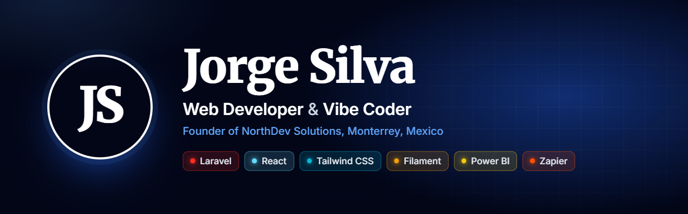
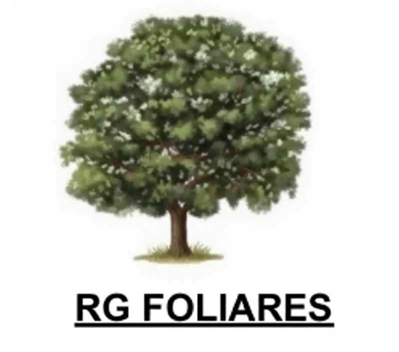

  

  
  
  
  

## Hi, I'm Jorge

I build web systems that take manual work off people's plates. Through **[NorthDev Solutions](https://northdevsolutions.com)** I design, build and maintain websites, ERPs, online stores, automations and Power BI dashboards for small and mid-sized businesses, from the first sketch to the server it runs on.

My background is in data analysis, so I care about what happens after launch: clean data, clear reports and processes that keep working without me. I'm proactive, orderly and creative, and I like proposing the next improvement before anyone asks for it.

## What I build

| | |
|---|---|
| **Websites** | Fast, mobile-first sites that turn visits into contact requests. |
| **ERP systems** | Inventory, orders, users and reports in one place, with roles and audit logs. |
| **E-commerce** | Catalog, cart and Stripe checkout, with an admin panel to run the store. |
| **Automation & APIs** | Shopify, forms, spreadsheets and accounting connected with Zapier and webhooks. |
| **Power BI dashboards** | Several data sources combined into one report the whole team trusts. |
| **Maintenance** | Updates, backups, security headers and monitoring for sites already live. |

## Featured work

<table>
  <tr>
    <td width="120" align="center"></td>
    <td>
      <b><a href="https://northdevsolutions.com">NorthDev Solutions</a></b>, my agency site 
      Services, portfolio and a contact flow with spam protection, plus five live demos (ERP, e-commerce, landing page, automation and Power BI) that clients can explore without signing up. 
      Laravel 12 · Blade · Tailwind CSS 4 · Filament 3 · GA4 with prior consent
    </td>
  </tr>
  <tr>
    <td width="120" align="center"></td>
    <td>
      <b><a href="https://rgfoliares.com">RG Foliares</a></b>, web application for an agricultural company 
      Records management, users and transactional email sent through Microsoft 365, with a redesigned front end and smooth scroll animations. 
      Laravel 12 · Microsoft Graph · Motion · Lenis · MySQL
    </td>
  </tr>
  <tr>
    <td width="120" align="center"></td>
    <td>
      <b><a href="https://hikaricandlesandco.com">Hikari Candles &amp; Co</a></b>, e-commerce for handmade candles 
      Seasonal catalogs, stock per product, scent and store location, Stripe checkout and an admin panel for the owners. 
      Laravel · Inertia.js · React · Tailwind CSS · Filament · Stripe
    </td>
  </tr>
</table>

## Tech stack

**Backend** 

**Frontend** 

**Data & reporting** 

**Integrations & automation** 

**Infrastructure & tools** 

**Design** 

**Currently learning** 

## How I work

- **Mobile first.** Every page is checked on a phone before it's checked on a desktop.
- **Security by default.** Strict security headers, validated input, rate limits and no secrets in the code.
- **Privacy that follows the law.** Analytics only load after consent, and privacy notices follow Mexico's LFPDPPP.
- **Tested before it ships.** Automated tests and CI on every project, so a change doesn't break what already works.
- **Built to be handed over.** Each demo is a real, working system that can be cloned and adapted for a client.

## GitHub stats

<picture>
  <source media="(prefers-color-scheme: dark)" srcset="https://readme-stats-fast.vercel.app/api/top-langs/?username=Jorge097&layout=compact&theme=github_dark&hide_border=true">
  
</picture>

## About me

Fast learner · Creative · Team player · Honest · Humble · Good sense of humor

## Let's talk

